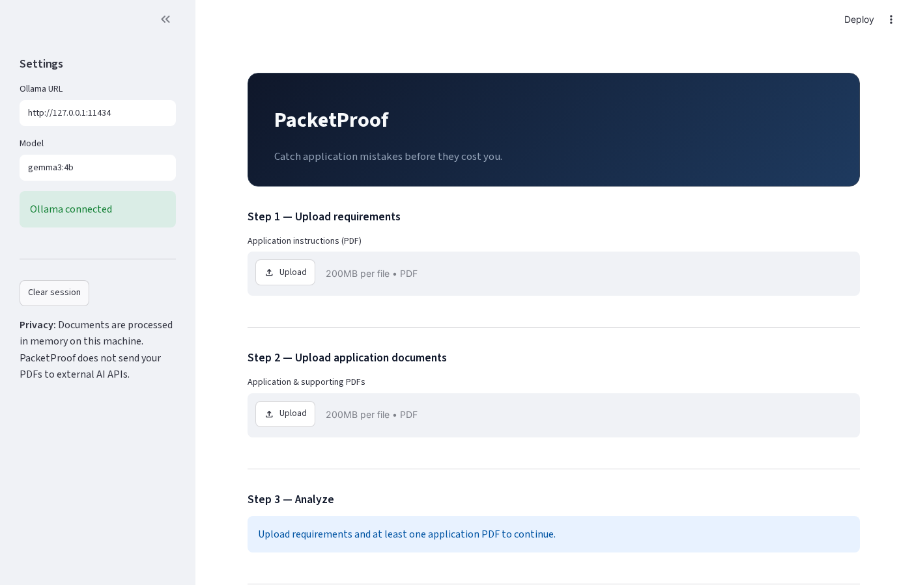

# DEV.to — PacketProof (Hacktoberfest Week 3 draft)

**Title:** I built PacketProof so Gemma catches scholarship paperwork mistakes—with receipts

**Tags:** `#hacktoberfest` `#opensource` `#ai` `#python` `#gemma`

---

## What problem does this solve?

Application packets are a checklist nightmare: transcripts, signatures, date windows, GPA floors. PacketProof reads your **requirements PDF** and **application PDFs**, uses **Gemma 3 4B** to extract requirements and match evidence, then a **Python verifier** checks that cited pages and quotes exist before anything is labeled verified.

## Theme: Slow and Steady

Local **Ollama** mode avoids shipping PDFs to the cloud. **OpenRouter** mode uses the same model (`google/gemma-3-4b-it`) when you want speed—clearly labeled **cloud** in the UI.

## How it works

1. PyMuPDF extracts text (warns on image-only pages).
2. Gemma extracts atomic requirements with source quotes.
3. Per requirement: semantic evidence match + quote validation.
4. Contradiction pass on names, dates, GPA, etc.
5. Dashboard: verified / missing / needs review + HTML export.



## Measured results (honest)

Structured evaluation on the Meridian demo (`evaluation/planted_match.py`):

| Metric | Result |
|--------|--------|
| Planted issue recall | **60%** (3/5) |
| Planted issue precision | **33%** |
| Analysis time (OpenRouter) | **~41 s** |

**Caught:** graduation date conflict, unsigned declaration, GPA below 3.0.  
**Missed:** missing transcript (soft needs_review), stale recommendation (wrongly verified).

We previously reported 5/5 using keyword search over the report JSON—that was **misleading** and is fixed.

## Limitations

- Model can verify the wrong thing confidently (see recommendation letter).
- Needs review ≠ missing; conservative by design.
- No OCR; text PDFs only.

## Try it

https://github.com/Souravrajvi0/packetproof

```bash
pip install -r requirements.txt
cp .env.example .env   # OPENROUTER_API_KEY optional
streamlit run app.py
```

**Video:** See `docs/VIDEO_STORYBOARD.md` — record 60–90 s and embed here before publish.

## Best Use of Gemma

Open-weight Gemma via Ollama or OpenRouter; evidence validation is the differentiator from a generic chat wrapper.
