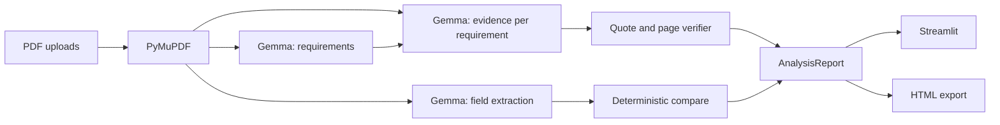

# PacketProof

**Catch application mistakes before they cost you.**

PacketProof is a privacy-first application inspector for scholarships, universities, grants, internships, jobs, and visas. Upload program instructions and your application PDFs; **local Gemma 3 4B** (via Ollama) extracts requirements, matches evidence, detects inconsistencies, and produces an **evidence-backed** submission readiness report—without sending documents to cloud AI APIs.

Hacktoberfest 2026 theme: **Slow and Steady — AI that rewards laziness.**

## Problem

Application packets combine long instruction PDFs with many supporting files. Manual cross-checking is slow and error-prone: missing transcripts, unsigned declarations, stale recommendation letters, and conflicting dates are easy to miss. PacketProof automates that review while **grounding every conclusion in verifiable citations** (filename, page, quoted text)—not a single “you’re good” chat reply.

## Features

| Area | What you get |
|------|----------------|
| Ingest | Multi-PDF upload, PyMuPDF extraction, unreadable-page warnings |
| AI (local) | Requirement extraction, semantic evidence matching, field extraction for contradictions |
| Trust layer | Page/quote verification, downgrade to **Needs review** when citations fail |
| UI | Streamlit dashboard: overview, checklist, filters, evidence inspector, action plan |
| Export | Downloadable HTML report (escaped user content) |
| Demo | Fictional Meridian Scholars scenario + `answer_key.json` |
| Quality | pytest suite + `evaluation/evaluate.py` |

## Architecture



## Why open-weight AI (Gemma)

- **Privacy:** Sensitive PII stays on your machine.
- **Portability:** Run the same workflow with different local models or quantizations.
- **Cost:** No paid inference API required for document review.

PacketProof is **not** a wrapper around a hosted chat API—the Ollama integration is the core reasoning path.

## Installation

**Requirements:** Python 3.11+, [Ollama](https://ollama.com/)

```bash
cd packetproof
python3.11 -m venv .venv
source .venv/bin/activate
pip install -r requirements.txt
```

### Ollama + Gemma

```bash
ollama pull gemma3:4b
# Ensure the Ollama service is running (default http://127.0.0.1:11434)
```

## Run the app

```bash
streamlit run app.py
```

Workflow: upload requirements PDF → upload application PDFs → **Analyze Application** → review dashboard → download HTML report. Use **Clear session** in the sidebar to discard uploads.

## Synthetic demo

```bash
python3.11 demo/generate_samples.py
```

1. Requirements: `demo/samples/meridian_requirements_2026.pdf`
2. Application set: all other PDFs in `demo/samples/`

Planted issues (see `demo/answer_key.json`): missing transcript, graduation date mismatch, stale recommendation letter, unsigned declaration, GPA below 3.0. Outputs are **not** hardcoded from the answer key—they flow through the live pipeline.

## Tests

```bash
PYTHONPATH=. python3.11 -m pytest
```

Covers PDF extraction, unreadable pages, quote/page validation, missing-document classification, field and date comparison, invalid model JSON, empty uploads, and Ollama connection failures.

## Evaluation

```bash
PYTHONPATH=. python3.11 evaluation/evaluate.py
```

Writes `evaluation/results/latest.json` with planted-issue detection heuristics, finding counts, and analysis duration.

### Measured results (CPU build VM, Oct 2026)

| Metric | Result |
|--------|--------|
| Unit tests | **16 passed** (`PYTHONPATH=. python3.11 -m pytest`) |
| Gemma requirement extraction (demo PDF) | **11 requirements** in **~13 min** (CPU-only EC2) |
| Full `evaluate.py` | **Slow on CPU** — use GPU machine or allow 1–3+ hours; see `evaluation/BENCHMARK.md` |

Repository: https://github.com/Souravrajvi0/packetproof

## Privacy and security

- Inference: local Ollama only (configurable URL in sidebar).
- Storage: uploads live in Streamlit session memory; clear with **Clear session**.
- Logging: app does not persist extracted text to disk.
- Limits: 25 MB / PDF, 200 pages / PDF.
- Untrusted PDF text: prompts treat document content as data; embedded “ignore instructions” text is not followed.
- Reports: HTML output escapes user-controlled strings.

## Known limitations

- Text-based PDFs only (**no OCR** in MVP).
- **Not applicable** status exists in the schema but conditional applicability is not fully automated—ambiguous cases surface as **Needs review**.
- Model may hallucinate citations; the verifier rejects unverifiable quotes.
- Per-requirement Gemma calls can be slow on large packets.
- No legal guarantee of eligibility, authenticity, or acceptance.

## Future improvements

- OCR for scanned documents
- Batched LLM calls
- PDF page highlighting
- Stronger conditional-requirement logic for **Not applicable**

## Project layout

See `app.py`, `core/`, `ui/`, `reports/`, `demo/`, `evaluation/`, `tests/`.

## License

MIT — see [LICENSE](LICENSE).
