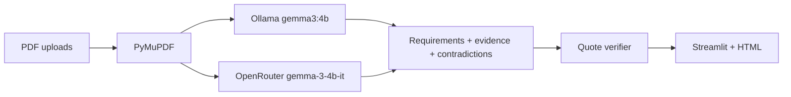

# PacketProof

**Catch application mistakes before they cost you.**

PacketProof inspects scholarship, job, and visa application packets with **open-weight Gemma 3 4B** and an evidence validation layer. Upload requirements and PDFs; get verified / missing / needs-review findings backed by **quotes, filenames, and page numbers**—not a chatbot guess.

Hacktoberfest 2026: **Slow and Steady** · **Best Use of Gemma**

## Two ways to run Gemma (you choose)

| Mode | Model | Privacy | Best for |
|------|--------|---------|----------|
| **Ollama (local)** | `gemma3:4b` | PDF text stays on your machine | Sensitive packets, Hacktoberfest local-AI story |
| **OpenRouter (cloud)** | `google/gemma-3-4b-it` | Extracted text sent to OpenRouter providers | Faster runs on CPU-only machines, demos, CI |

Same pipeline either way: PyMuPDF → Gemma → quote verifier → dashboard + HTML report.

## Problem

Manual cross-checking of requirements vs. uploads is tedious and error-prone. PacketProof automates it while **grounding conclusions in verifiable citations**.

## Features

| Area | What you get |
|------|----------------|
| Ingest | Multi-PDF upload, PyMuPDF, unreadable-page warnings |
| AI | Gemma 3 4B via **Ollama** or **OpenRouter** |
| Trust layer | Page/quote verification → **Needs review** when citations fail |
| UI | Streamlit, evidence inspector, action plan, HTML export |
| Demo | Meridian Scholars packet + `answer_key.json` |
| Quality | 21 tests + `evaluation/evaluate.py` with structured planted-issue matching |

## Architecture



## Installation

```bash
cd packetproof
python3.11 -m venv .venv && source .venv/bin/activate
pip install -r requirements.txt
cp .env.example .env   # optional OpenRouter key
streamlit run app.py
```

### Local — Ollama

```bash
ollama pull gemma3:4b
```

Select **Ollama — local Gemma** in the sidebar.

### Cloud — OpenRouter

Add to `.env`:

```bash
OPENROUTER_API_KEY=sk-or-v1-...
PACKETPROOF_INFERENCE=openrouter   # optional default
```

Select **OpenRouter — hosted Gemma** in the sidebar. Optional free slug: `google/gemma-3-4b-it:free`.

## Evaluation

```bash
PYTHONPATH=. python3.11 evaluation/evaluate.py
```

Uses `evaluation/planted_match.py` (per-finding rules, not keyword grep).

### Measured results (Gemma 3 4B, Oct 24, 2026)

| Metric | Result |
|--------|--------|
| Unit tests | **21 passed** |
| Requirements extracted | **11** |
| Verified / missing / needs review | **2 / 0 / 9** |
| Planted issue recall / precision | **60%** / **33%** |
| Analysis time | **~41 s** |

Benchmark run via OpenRouter; **identical Gemma 3 4B weights**—reproduce with Ollama locally if you prefer.

## Privacy

- **Ollama:** Document text processed on your hardware (default privacy path).
- **OpenRouter:** Extracted text leaves your machine—use only if that fits your threat model.
- Session memory only; **Clear session** in sidebar. No PII logged to disk by the app.

## Repository

https://github.com/Souravrajvi0/packetproof

## License

MIT
