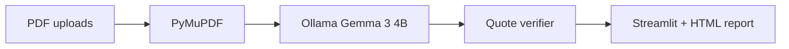

# PacketProof

**Catch application mistakes before they cost you.**

PacketProof is a **privacy-first, local-AI** application inspector for scholarships, universities, grants, internships, jobs, and visas. Upload program instructions and application PDFs; **Gemma 3 4B through Ollama** extracts requirements, matches evidence, flags gaps and inconsistencies, and produces an **evidence-backed** readiness report—without sending documents to cloud AI APIs.

Hacktoberfest 2026: **Slow and Steady — AI that rewards laziness** · **Best Use of Gemma**

## Problem

Application packets combine long instruction PDFs with many supporting files. Manual cross-checking is slow and error-prone. PacketProof automates review while **grounding every conclusion in verifiable citations** (filename, page, quoted text).

## Features

| Area | What you get |
|------|----------------|
| Ingest | Multi-PDF upload, PyMuPDF extraction, unreadable-page warnings |
| AI (local) | Gemma 3 4B via Ollama — requirements, evidence, contradictions |
| Trust layer | Quote/page verification; weak citations → **Needs review** |
| UI | Streamlit dashboard, evidence inspector, HTML export |
| Demo | Meridian Scholars synthetic packet + `answer_key.json` |
| Quality | pytest + structured `evaluation/evaluate.py` |

## Architecture



## Why open-weight Gemma (local)

- **Privacy:** Applicant PII stays on your hardware.
- **No inference API required** for normal use.
- **Portable:** Swap quantizations or models without vendor lock-in.

## Installation

**Python 3.11+** and **[Ollama](https://ollama.com/)**

```bash
cd packetproof
python3.11 -m venv .venv && source .venv/bin/activate
pip install -r requirements.txt
ollama pull gemma3:4b
streamlit run app.py
```

## Synthetic demo

```bash
python3.11 demo/generate_samples.py
```

Upload `demo/samples/meridian_requirements_2026.pdf` plus the other PDFs in `demo/samples/`.

## Tests

```bash
PYTHONPATH=. python3.11 -m pytest
```

## Evaluation

```bash
ollama serve   # if needed
PYTHONPATH=. python3.11 evaluation/evaluate.py
```

Uses structured planted-issue matching (`evaluation/planted_match.py`), not keyword grep.

### Measured results (Gemma 3 4B, Oct 24, 2026)

| Metric | Result |
|--------|--------|
| Unit tests | **21 passed** |
| Requirements extracted | **11** |
| Findings (verified / missing / needs review) | **2 / 0 / 9** |
| Contradictions | **1** |
| **Planted issue recall** | **60%** (3/5) |
| **Planted issue precision** | **33%** |
| Analysis time | **~41 s** |

**True positives:** graduation date conflict; unsigned declaration; GPA below 3.0.  
**Misses:** missing transcript (needs_review only); stale recommendation (wrongly verified).

Reproduce on your machine with **local Ollama** for the Hacktoberfest story. Maintainer-only cloud backend: see `docs/OPTIONAL_CLOUD_INFERENCE.md` (not used in public write-ups).

## Privacy

- **Default:** Ollama on `127.0.0.1` — document text is not sent to PacketProof or third-party AI APIs.
- Session-only storage; **Clear session** in the sidebar.
- Limits: 25 MB / PDF, 200 pages; text PDFs only (no OCR in MVP).

## Limitations

Not legal advice; no guarantee of acceptance. Model errors possible—verifier downgrades unverifiable quotes.

## Repository

https://github.com/Souravrajvi0/packetproof

## License

MIT
